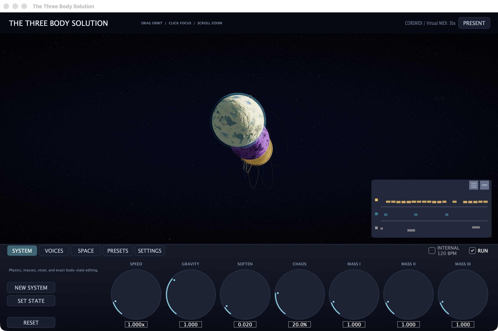

# The Three Body Solution

The Three Body Solution (`3bs`) is a deterministic
generative MIDI instrument and cinematic planetary artwork. Three bodies move
through a fixed-step gravitational simulation; their distances, velocities,
phases, and crossings become three interlocking musical voices.

[](https://krahd.github.io/3bs/)

**[Project website](https://krahd.github.io/3bs/)** ·
**[Download v0.1.0-alpha.3](https://github.com/krahd/3bs/releases/tag/v0.1.0-alpha.3)** ·
**[Installation guide](doc/INSTALL.md)** ·
**[Project status](STATUS.md)**

> [!WARNING]
> The downloadable Apple silicon binaries are alpha software. They are ad-hoc
> signed, not notarized, and have not completed Logic or Ableton host validation.

## Three Formats, One Engine

| Format | Role | Typical use |
| --- | --- | --- |
| Audio Unit | Logic MIDI effect | Insert before a software instrument |
| VST3 | MIDI-generating instrument | Route MIDI output to an instrument track |
| Standalone | CoreMIDI application | Send a virtual or physical MIDI output without a DAW |

All three surfaces share the same C++20 simulation and mapping engine. Given the
same seed, state, transport, and inputs, the musical result is reproducible and
independent of audio block size.

## What It Does

- Runs a fixed-step, double-precision three-body simulation in normalized
  artistic units.
- Maps orbital relationships to pitch, trigger, velocity, duration, and CC
  streams across three independently configurable voices.
- Provides mutually exclusive independent, chord, and strum modes with
  deterministic scheduling, plus 12 voice-only factory presets.
- Maps orbital measurements to note lengths quantized onto straight rhythmic
  values from 1/32 through two whole notes; legacy sessions retain continuous
  duration mapping.
- Renders procedural planets, atmospheres, trajectories, a pinned HYG star
  catalogue, HDR bloom, and six seconds of live body-coloured note history.
- Ships 24 deterministic factory systems, 12 dedicated voicing presets, and
  portable, human-readable `.3bs` configuration files.
- Keeps rendering off the MIDI processing thread and uses fixed-capacity queues
  for real-time communication.

## Install a Release

Download the [complete bundle or one format][release], verify its published
SHA-256 checksum, and follow the [installation guide](doc/INSTALL.md). Releases
target Apple silicon Macs running macOS 13 or newer.

The standalone creates a virtual CoreMIDI output and can select an existing
destination. It generates MIDI rather than audio. Press `P` for presentation
mode and `F` for fullscreen.

## Build From Source

Requirements:

- Apple silicon Mac running macOS 13 or newer
- Xcode and its command-line tools
- CMake 3.22 or newer
- Python 3 for preset diagnostics and candidate packaging
- Git with submodule support

JUCE 8.0.13 is pinned as a submodule. Build and test the framework-independent
core:

```bash
git clone --recurse-submodules https://github.com/krahd/3bs.git
cd 3bs
cmake --preset dev
cmake --build --preset dev -j 8
ctest --preset dev --output-on-failure
```

Build the AU, VST3, standalone, and integration tests:

```bash
cmake --preset plugin-debug
cmake --build --preset plugin-debug -j 8
ctest --preset plugin-debug --output-on-failure
```

Debug bundles are written below `build/plugin-debug`:

- `src/plugin/ThreeBSAU_artefacts/Debug/AU/`
- `src/plugin/ThreeBSVST3_artefacts/Debug/VST3/`
- `src/standalone/ThreeBSStandalone_artefacts/Debug/`

Local builds are ad-hoc signed by default. Set `THREEBS_ADHOC_SIGN=OFF` for a
Developer ID signing and notarization workflow.

In VS Code, run **Tasks: Run Task** and choose
`3bs: Build and Install Plugins` to create Release AU/VST3 bundles and install
them into the current user's `~/Library/Audio/Plug-Ins` directories. The same
operation is available from the terminal:

```bash
./scripts/build_install_plugins.sh
```

Release maintainers can build, test, verify, and package all downloadable
formats with:

```bash
./scripts/package_plugins.sh v0.1.0-alpha.3
```

## Use It

The control deck has five pages:

- **System:** run state, physics, masses, deterministic randomization, and exact
  initial position/velocity editing.
- **Voices:** per-body enable, root, scale, pitch/trigger/duration mappings,
  density and shared chord/strum controls. **Voice / System Settings** exposes
  channel, note range, custom scales, trigger intervals, probability, velocity
  and CC lanes, plus existing simulation settings.
- **Space:** trails, bloom, orbital-plane tilts, automatic framing, and
  camera limits.
- **Presets:** 24 factory systems grouped by orbital family.
- **Settings:** portable `.3bs` import/export, authored configurations and the
  standalone MIDI destination. **Save Copy** creates a new authored file;
  **Folder** opens its location for rename or removal.

**All Notes Off** releases generated notes and cancels pending strums. Exact
state editing preserves full numeric precision. Accepted masses above the
coarse slider range remain active until that slider is moved. The density
control replaces per-voice probabilities when moved; advanced probability
settings otherwise remain independent.

Standalone generation uses its own monotonic clock and continues while the
interface is busy. A timing fault pauses generation until Reset or a fresh Run
transition. Physical destinations are monitored for disconnection and
reconnection; a route change cleans the old destination first.

Drag the scene to orbit, scroll to zoom, click a body to follow it, and click the
background to return to the barycenter. Double-click the background to fit all
bodies while preserving the view angle. Manual zoom disables auto-frame until
it is re-enabled on the Space page.

## Architecture and State

`src/core/` owns physics, measurements, mapping, scheduling, deterministic PRNG
state, and bounded queues. JUCE adapters translate host transport and MIDI for
the plugin and standalone surfaces. Metal consumes immutable render snapshots
and a separate note-event queue, so renderer failure is non-fatal to MIDI.

Source builds use schema-v8 host state and schema-v4 portable `.3bs` files.
They preserve exact simulation vectors, musical mappings, meter, rhythmic
length grids, camera and pane state, and non-automatable presentation controls.
Host schemas v1–v7 and portable schemas v1–v3 migrate with defined defaults.
Older portable files lack meter and import as host-source 4/4; standalone uses
the saved manual values. Existing parameter IDs and normalisation ranges are
unchanged. Factory presets remain schema v2; voicing presets remain schema v1.
The downloadable alpha.3 binaries predate these source changes. See
[`STATUS.md`](STATUS.md) for diagrams, test records, and current risks.

## Validation and compatibility

The [reliability acceptance record](RELIABILITY-ACCEPTANCE.md) distinguishes
automated evidence from actual DAW and hardware sessions. CI executes portable
and native regressions, numerical diagnostics, concurrent ownership checks,
real drawable Metal tests, UI captures and plugin validators. A runner without
Metal or CoreMIDI reports a skip. Candidate archives include the exact commit
and SHA-256 checksums. They are ad-hoc signed development builds.

Corrections to explicit voice construction, SpeedPeak triggering, input sample
timing and tempo-relative strums can change traces previously produced by
defects. The solver, factory data and gravitational mapping concept are
unchanged. State compatibility preserves authored values; it does not reproduce
those defects. MIDI buffer capacity and final plugin teardown also depend on
the host API and require the recorded host acceptance sessions.

## Host Routing

Logic uses `3bs` as an AU MIDI effect before a software instrument. In Ableton,
the VST3 is a MIDI-generating instrument and therefore occupies the track's
instrument slot; place it on one MIDI track and receive its output on a second
instrument track. For one destination track, run the standalone application,
choose `Virtual MIDI: 3bs`, then select `The Three Body Solution` as that track's
MIDI input. A device placed
before an instrument in the same Live chain requires a dedicated Max for Live
MIDI Effect rather than a VST3. Ableton merges internally routed MIDI channels,
so independent instruments require multiple instances or a multitimbral
destination.

Local AU validation command:

```bash
auval -v aumi Tbs1 Tmlz
```

## Documentation

- [Installation and release use](doc/INSTALL.md)
- [Operational status and architecture](STATUS.md)
- [Reliability implementation and acceptance](RELIABILITY-ACCEPTANCE.md)
- [Dated audit and improvement plan](AUDIT-AND-IMPROVEMENT-PLAN.md)
- [Original project description](doc/project-initial-description.md)
- [Historical implementation tasks](doc/)
- [Contributor instructions](AGENTS.md)

## Licensing

Copyright © 2026 Tomas Laurenzo.

The project is free software under the GNU Affero General Public License version
3 only. See [`LICENSE`](LICENSE). Distributed binaries are accompanied by the
corresponding source and build information. Third-party notices are recorded in
[`THIRD_PARTY_NOTICES.md`](THIRD_PARTY_NOTICES.md).

[release]: https://github.com/krahd/3bs/releases/tag/v0.1.0-alpha.3
